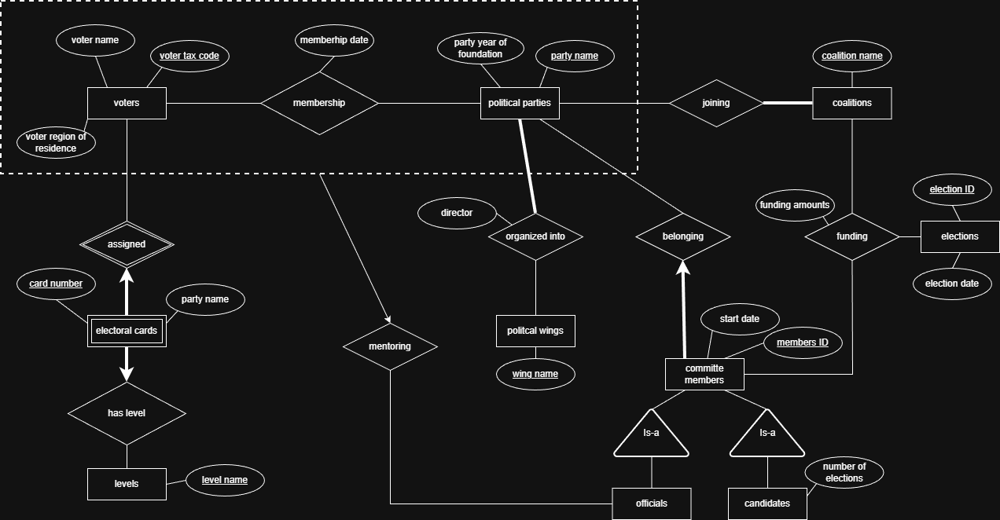

# Database design and SQL

Three related assignments model people, parties and funding in a political-membership database. The work moves from relational design to SQL analysis and a funding data warehouse, with particular attention to what queries should return for empty groups and tied rankings.

The work includes a **15-table schema**, eight analytical queries and a dimensional model with two additive funding measures. Small synthetic examples check cases that are easy to miss, such as ties, empty memberships and missing funding.

## Design and queries

| Assignment | Work | Files |
| :--- | :--- | :--- |
| Relational design | E/R model and 15-table schema | [Report](01-relational-design/report.pdf) · [DDL](01-relational-design/schema.sql) |
| SQL | Eight queries with joins, aggregates, CTEs and anti-joins | [Queries](02-queries/queries.sql) |
| Data warehouse | Attribute trees, dimensional fact model and two additive measures | [Report](03-data-warehouse/report.pdf) · [Measures](03-data-warehouse/measures.sql) |



One query asks for voters whose memberships all belong to coalition parties. Voters with no memberships must also satisfy that condition; a simple inner join would omit them. Other queries handle tied rankings and date cutoffs. The warehouse measures aggregate funding amounts and counts by funding day, election date, coalition and party.

## What the checks establish

The synthetic fixture exercises all eight queries, including ranking ties, zero memberships, missing funding and the date boundary. Warehouse checks compare aggregate totals. Query semantics run on DuckDB 1.5.1, while a separate SQLite check verifies creation and cascading behaviour of the transcribed DDL.

These are three assignments rather than one migration chain: the query and warehouse exercises use the instructor's schema, whose names differ from the first design. The fixture contains only the columns needed by the queries.

## Contribution

**Matteo Pietro Di Pilato** · Data and Knowledge Bases, BSc in Artificial Intelligence, 2025/26. The work covers the E/R and dimensional designs, SQL solutions and later executable checks.

## Limits and next steps

The course used PostgreSQL; these checks do not yet validate its specific behaviour. The first design also lacks SQL enforcement of the exclusive and exhaustive official/candidate subtype constraint. Query 8 ranks only parties present in `memberships`, so zero-member parties are omitted even when zero would be the second distinct count.

The next step is a PostgreSQL integration fixture and explicit tests of those two design/query cases.

## Run

```bash
git clone https://github.com/pdmdp/database-design-and-sql.git
cd database-design-and-sql
python -m pip install -r requirements.txt
python -m unittest discover -s tests -v
```

The fixture uses fictional identifiers. The [source manifest](source-manifest.json) identifies the original SQL and reports; the fixture and checks are later additions.
